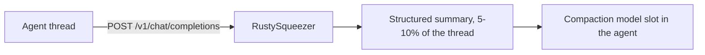

<div class="eyebrow">Open source · MIT · Rust</div>

# RustySqueezer

**A fake LLM for context compaction.** It exposes OpenAI, Anthropic and Ollama
compatible endpoints that answer a compaction request with a deterministic,
extractive summary of the thread - without calling any language model.

[Quick start](#quick-start){: .md-button .md-button--primary }
[Integrations](integrations/zed.md){: .md-button }
[Why it exists](#why-this-exists){: .md-button }

## Quick start

```{ .bash .term }
$ docker run -d -p 8000:8000 ghcr.io/handtrixx/rustysqueezer:latest

$ curl -s localhost:8000/health
{"status":"ok","model":"rustysqueezer"}

$ curl -s localhost:8000/v1/chat/completions \
  -H 'content-type: application/json' \
  -d @thread.json
# 189k tokens in -> 1.3k tokens out, deterministic, ~4 ms
```

<div class="rs-cards" markdown="1">

<div class="rs-card" markdown="1">
**No model calls**

Pure extraction. Deterministic, byte-identical output for the same input, which keeps prefix caches warm.
</div>

<div class="rs-card" markdown="1">
**Drop-in surfaces**

OpenAI `/v1/chat/completions`, Anthropic `/v1/messages` (including native compaction blocks), Ollama `/api/chat` and `/api/generate`.
</div>

<div class="rs-card" markdown="1">
**Tiny**

~4 MB RSS, 64 MiB request bodies, a million-token thread compacts in about a tenth of a second.
</div>

<div class="rs-card" markdown="1">
**Private by default**

No auth, no outbound network, runs on a private Docker network behind your gateway.
</div>

</div>

## Why this exists

Agents compact a long thread by sending the *whole* thread to a summarising
model. That request has to fit inside the summariser's own context window, so a
local model with a modest window (e.g. 131k tokens) cannot compact its own
threads - you end up paying a 1M-context cloud model for every compaction event.

The insight: **compaction does not need a model.** It needs a good extractive
summary of what was asked, what was run, what broke, and what was just said.

`rustysqueezer` does exactly that, in a few milliseconds, for free, and always
produces byte-identical output for the same input.

## How it works



1. **Detect the compaction request.** The last user message is matched against
   `instruction_patterns` (Zed, Claude Code-style `/compact`, generic
   "summarize the conversation so far") and treated as the instruction, not
   thread content.
2. **Split the thread** into the original task, follow-up user messages and
   assistant turns.
3. **Extract facts from tool calls** (`tool_calls` and tool results): commands
   that ran, files and paths touched, tool names.
4. **Pick key assistant sentences** scored by task-term overlap plus recency -
   a TF-IDF-ish heuristic, no model.
5. **Collect error lines** using a configurable regex.
6. **Append the verbatim tail** - the last `TAIL_TURNS` turns, clipped to
   `TAIL_CHARS`.

!!! warning "This is a proof of concept, not a product"
    There is no authentication, no rate limiting and no abstractive
    clustering. The compaction itself is solid and evaluated, but treat it as
    infrastructure you run on a private network.

## Deploy

```bash
docker run -d -p 8000:8000 \
  -e MAX_SUMMARY_CHARS=12000 \
  ghcr.io/handtrixx/rustysqueezer:1.0.6
```

CI publishes `:latest`, `:<sha>`, `:<version>` and `:v<version>` tags on every
push to `main`, and the image is public - no login needed.

## Where to go next

<div class="rs-cards" markdown="1">

<div class="rs-card" markdown="1">
**[Zed](integrations/zed.md)**

Point `agent.compaction_model` and `agent.thread_summary_model` at RustySqueezer.
</div>

<div class="rs-card" markdown="1">
**[LiteLLM](integrations/litellm.md)**

Gateway-side compaction with the auto-router, so any client benefits.
</div>

<div class="rs-card" markdown="1">
**[VS Code](integrations/vscode.md)**

Copilot has no compaction knob; the gateway route covers it.
</div>

<div class="rs-card" markdown="1">
**[OpenCode](integrations/opencode.md)**

Native `agents.compaction.model` support.
</div>

</div>
