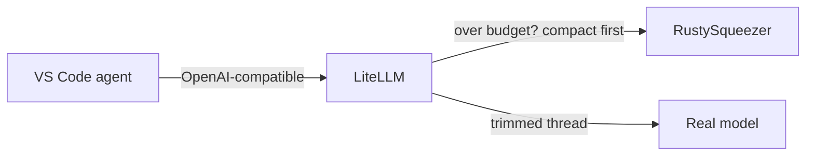

# VS Code (GitHub Copilot)

GitHub Copilot's agent compacts context internally and **does not expose a
user-settable compaction model**. There is no `compaction_model` equivalent to
Zed's. So the only way RustySqueezer helps VS Code is gateway-side: put
LiteLLM in front of the model and let the router compact before dispatch.

## The gateway route

1. Configure LiteLLM as in the [LiteLLM guide](litellm.md): a router entry with
   an honest declared window, and `context_compaction` on the auto-router with
   `rusty-compactor` pointing at RustySqueezer.
2. Point the VS Code agent at LiteLLM's base URL as its OpenAI-compatible
   endpoint.
3. Copilot sends full threads to LiteLLM; LiteLLM compacts anything over the
   trigger and forwards a trimmed thread to the real model.

!!! note "Which clients can be re-pointed"
    This works for VS Code agents that let you set a custom OpenAI-compatible
    base URL (Continue, Cline, and custom scripts). Copilot's own "bring your
    own key" flow lets you choose a provider, but not an arbitrary base URL, so
    it cannot be routed through your gateway directly.

## RustySqueezer as an Ollama model

RustySqueezer also implements the Ollama surfaces (`/api/chat`,
`/api/generate`, `GET /api/tags`), so it shows up in tooling that discovers
models from an Ollama-style server. Copilot's local-model support can list it
this way - but Copilot would then use it as the chat model, not as a
summariser, so this is only useful for agents that have a separate
summariser slot.

!!! tip "Rule of thumb"
    If a client has a compaction setting, use it (Zed, OpenCode). If it does
    not, put the gateway in front and let LiteLLM do the compaction - that is
    the whole reason the gateway-side path exists.
